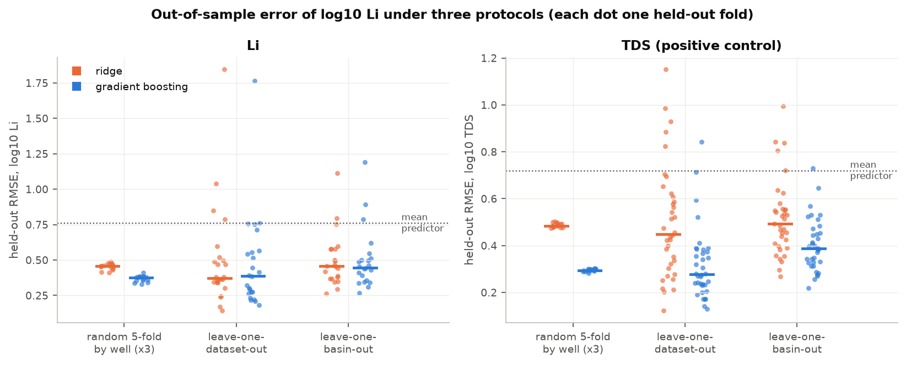
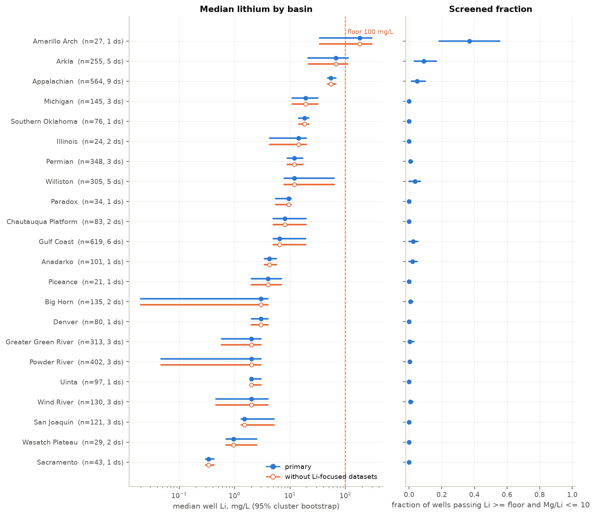

# Produced-Water Lithium

Where is lithium in U.S. oil and gas produced water, and how much of that picture is an
artifact of what was sampled, measured and compiled? A pre-registered screening and
prediction study on the USGS National Produced Waters Geochemical Database v3.0, built and
verified under the [cairn](https://github.com/ethannol/cairn) harness.

## What the analysis shows

The database can support an initial screen of measured wells, but it cannot establish
how much lithium a basin contains. Few measured wells meet both screening criteria,
and model performance varies substantially when predicting a new basin. Missing
measurements and differences between source datasets constrain the conclusions.

This study combines a data-quality audit, basin comparisons with uncertainty, and
prediction evaluated on held-out wells, datasets, and basins.

[Read the report](reports/report.md) · [Five-minute walkthrough](docs/walkthrough.md) · [Reproduce the analysis](#setup)



<details>
<summary>Detailed findings and estimates</summary>

All estimates below are rendered from the recorded results in `artifacts/numbers.json`.


- **Non-detects cannot be identified in v3.0.** The lithium column has {{nondetect.Li.nonempty}}
  values, {{nondetect.Li.zero}} zeros, {{nondetect.Li.negative}} negatives and
  {{nondetect.Li.lt_prefixed}} flags; the dictionary has {{nondetect.dictionary_detection_fields}}
  detection-limit fields. A result below detection is an empty cell, indistinguishable
  from "not analyzed".
- **Few wells pass.** Of {{screen.n_li_wells}} wells with lithium, {{screen.n_above_floor}}
  reach {{screen.floor_mg_l:g}} mg/L and {{screen.n_pass_primary}}
  ({{screen.share_pass_primary:.1%}}) also meet Mg/Li <= {{screen.ceiling_mg_li:g}}.
  {{screen.n_basins_ranked}} basins have at least {{screen.min_wells_basin}} lithium wells;
  {{screen.n_basins_frac_interval_excludes_zero}} have a screened fraction whose interval
  excludes zero: {{screen.pass1.name}} ({{screen.pass1.n_pass}} of {{screen.pass1.n_wells}}
  wells), {{screen.pass2.name}} ({{screen.pass2.n_pass}} of {{screen.pass2.n_wells}}) and
  {{screen.pass3.name}} ({{screen.pass3.n_pass}} of {{screen.pass3.n_wells}}). By median
  lithium the leader is {{screen.basin1.name}} at {{screen.basin1.median_li:.0f}} mg/L, but
  on {{screen.basin1.n_wells}} wells from one dataset with centroid coordinates and an
  interval of {{screen.basin1.median_lo:.0f}} to {{screen.basin1.median_hi:.0f}}; then
  {{screen.basin2.name}} ({{screen.basin2.median_li:.0f}}, {{screen.basin2.median_lo:.0f}} to
  {{screen.basin2.median_hi:.0f}}, {{screen.basin2.n_wells}} wells) and {{screen.basin3.name}}
  ({{screen.basin3.median_li:.0f}}, {{screen.basin3.median_lo:.0f}} to
  {{screen.basin3.median_hi:.0f}}, {{screen.basin3.n_wells}} wells).
- **The named compilation bias is small; dataset effects are large.** The four datasets
  the USGS version history calls lithium-focused hold {{screen.adj.n_li_wells_removed}}
  lithium wells; removing them changes nothing ({{screen.adj.top5_overlap}} of `5` top
  basins kept, {{screen.adj.n_reversed_pairs}} reversals). But within basins that have
  more than one dataset, dataset medians differ by a median factor of
  {{screen.ds.median_ratio:.1f}} and up to {{screen.ds.max_ratio:.0f}}.
- **Missing is not random.** Lithium was measured on {{miss.share_measured:.1%}} of rows;
  {{miss.datasets_none_measured}} of {{miss.datasets_total}} datasets never measured it,
  {{miss.decade_top_measured_share:.0%}} of dated lithium rows are from the 1960s, and a
  model predicts whether a row has lithium with AUC {{miss.auc:.2f}}.
- **Prediction works within basin, degrades across datasets and basins.** Gradient
  boosting on major-ion log-ratios, TDS, depth, play type and era: RMSE of log10 Li
  {{model.random.hgb.rmse_pooled:.2f}} under random folds by well (folds
  {{model.random.hgb.rmse_fold_min:.2f}} to {{model.random.hgb.rmse_fold_max:.2f}}),
  {{model.lodo.hgb.rmse_pooled:.2f}} leaving one dataset out ({{model.lodo.hgb.rmse_fold_min:.2f}}
  to {{model.lodo.hgb.rmse_fold_max:.2f}}), {{model.lobo.hgb.rmse_pooled:.2f}} leaving one
  basin out ({{model.lobo.hgb.rmse_fold_min:.2f}} to {{model.lobo.hgb.rmse_fold_max:.2f}});
  a mean predictor scores {{model.target_sd:.2f}}. R-squared {{model.random.hgb.r2_pooled:.2f}},
  {{model.lodo.hgb.r2_pooled:.2f}}, {{model.lobo.hgb.r2_pooled:.2f}}. The pre-registered rule
  returns "{{model.verdict}}", but precision at the floor falls from
  {{model.random.hgb.cls_precision:.2f}} to {{model.lobo.hgb.cls_precision:.2f}} out of basin
  and only {{model.lobo.hgb.n_basins_r2_ge_0_3}} of {{model.n_basins_heldout}} held-out
  basins are predicted usefully on their own. Positive control (TDS from the same
  features): R-squared {{control.random.hgb.r2_pooled:.2f}}, {{control.passes}}.

Read the [full report](reports/report.md) or the [five-minute walkthrough](docs/walkthrough.md).



</details>

## What is not claimed

No resource estimate, no economic conclusion, no claim about any company or site. No claim
below basin scale ({{prepare.wells.li_wells_share_coord_approx:.0%}} of lithium wells have
centroid coordinates). The ranking describes wells that were analyzed for lithium, not
basins. Thresholds are literature screening values. Non-detects cannot be recovered from
this version of the database.

## Setup

Requires Python 3.12 and [uv](https://docs.astral.sh/uv/). From the cloned repository:

```bash
python3 scripts/bootstrap.py
```

This installs dependencies from the lockfile and checks out Cairn at the study's
recorded revision (`1d6e81093eeb4f81cd36d77fa1a47903f0e3be91`) in `../cairn-lithium-baseline`.
It leaves existing checkouts untouched and refuses a baseline folder with a different
revision or uncommitted changes. The initial installation needs network access.

To reproduce the analysis after installation:

```bash
uv run pytest                # focused tests of every component
uv run cairn run             # scripts/00..60 in order, offline, from the committed extract
uv run cairn verify          # frozen plan, checks, lint, placeholders, clean rerun
uv run cairn render          # reports/report.md from report.tmpl.md and the ledger
uv run python scripts/download.py   # ONLY to refresh the archive and extract (network); re-freeze after
```

After installation, the analysis runs offline from the committed extract.
The model steps set `OMP_NUM_THREADS=1` and run folds in parallel processes.

## Data provenance

- U.S. Geological Survey National Produced Waters Geochemical Database, version 3.0
  (December 2023), doi:10.5066/P9DSRCZJ, public domain. Citation in `data/raw/manifest.json`.
- The {{manifest.archive_bytes}}-byte workbook (SHA-256 `{{manifest.archive_sha256}}`) stays in
  `data/archive/` (gitignored). `data/raw/npwgd_v3_extract.csv` is a deterministic
  {{manifest.extract_rows}}-row, {{manifest.extract_columns}}-column extract written once by
  `scripts/download.py`; the manifest holds the URLs, HTTP headers, sizes and SHA-256 of
  every archive file and of the extract. The extract is hashed by `cairn freeze` and is
  never modified; all cleaning happens downstream with `data/derived/exclusion_log.csv`.
- Metadata XML, version history and the data dictionary are committed beside the extract.
  Field notes: `docs/data_dictionary.md`.

## Layout

```
src/pwlithium/   acquire, extract, prepare, screen, features, models, cv, missing, figures, util
scripts/         00_profile 10_prepare 20_missingness 30_screen 40_model 45_control 50_figures 60_docs; download.py
data/raw/        committed extract, manifest, metadata, version history, dictionary (frozen)
data/derived/    included rows, wells, lithium wells, exclusion log, out-of-fold predictions
artifacts/       numbers.json (ledger), checks.jsonl
reports/         report.md (rendered), figures/, tables/
docs/            prereg.md (frozen), decisions.md, data_dictionary.md, walkthrough.md, resume_bullet.md
tests/           {{tests.n_tests}} pytest tests
```

## How AI was used

This project was built in a Claude Code session with Claude Fable 5.1 from the project
brief: the agent verified the download URLs, inspected the archive, found and cited the
threshold sources, wrote the pre-registration, the code, the tests and the templates, and
ran the pipeline under cairn. The author reviewed the pre-registration, the tests and the
findings. No language model is called by the pipeline.

## License

MIT for the code. The USGS data are public domain.


## Practical applicability and supplementary coverage

Passing the frozen pooled usefulness rule does not establish reliable screening in each new basin. Held-out screening precision is {{model.lobo.hgb.cls_precision:.2f}}, and only {{model.lobo.hgb.n_basins_r2_ge_0_3}} of {{model.n_basins_heldout}} basins meet the R-squared bar. These limits govern application of predictions to unmeasured wells.

The [supplementary screening and calibration audit](docs/screening-calibration.md) separates missing-Mg unknowns from failures and reports reliability by held-out basin and dataset with bin support. Its outputs are exploratory and do not change the frozen screen denominator or model verdict.
