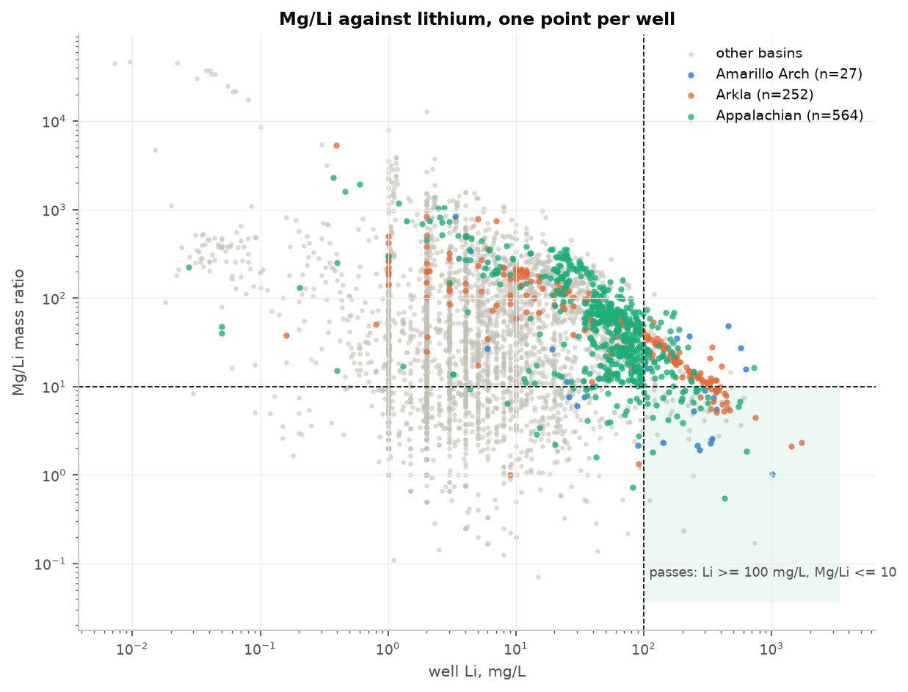
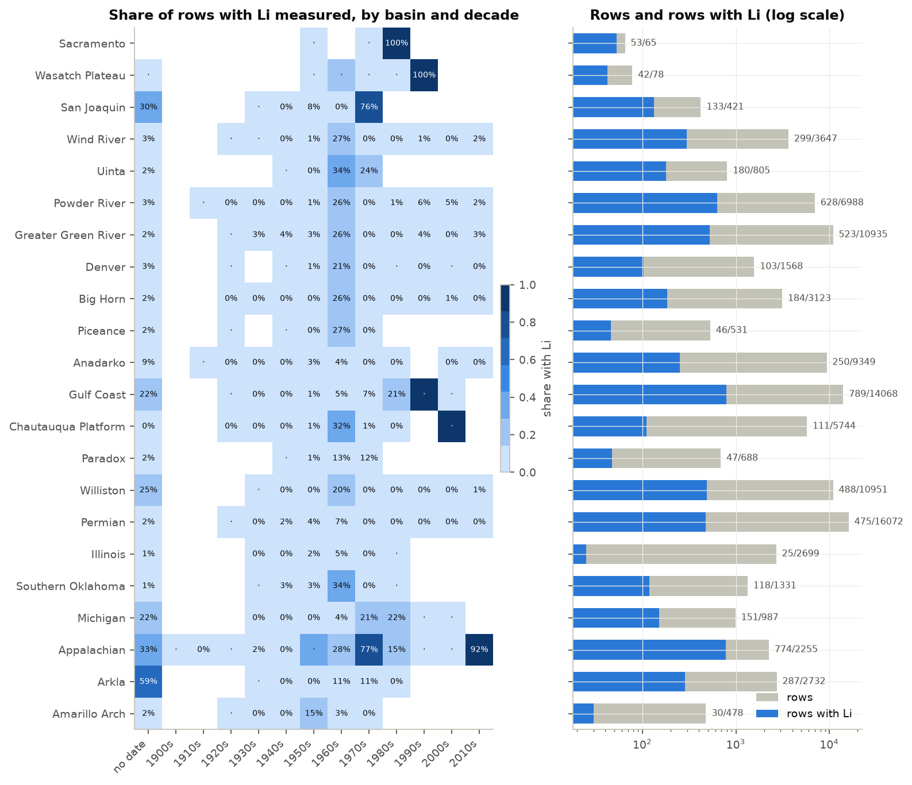
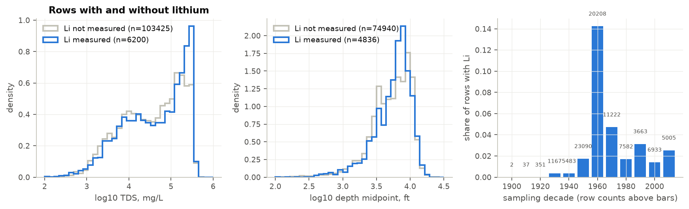
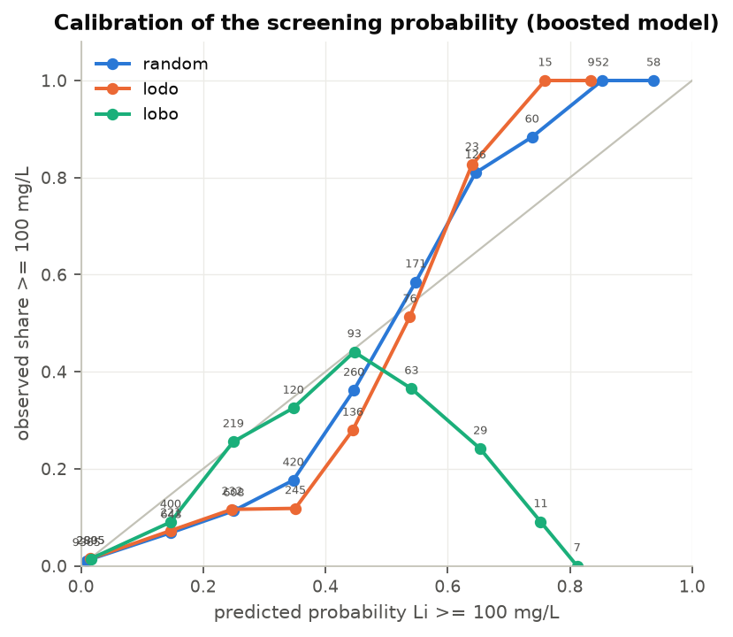
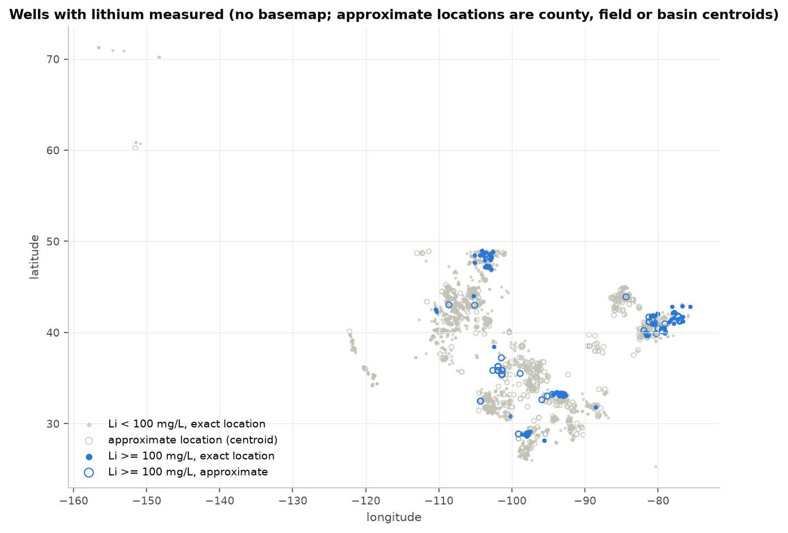

# Produced-water lithium: where it is, and how much of that is the compilation

_Rendered by `cairn render` from `artifacts/numbers.json`; every figure below is a ledger
value. Do not edit `reports/report.md`. The analysis plan was frozen in `docs/prereg.md`
before any ranking or model fit; anything outside it is marked exploratory._

## Question

Which U.S. basins and formations in the USGS National Produced Waters Geochemical
Database v3.0 have produced-water lithium and major-ion chemistry that pass a
pre-registered screen (Li >= 100 mg/L and Mg/Li <= 10,
mass ratio), with uncertainty, and how much does that picture change when the known
biases of the compilation are accounted for? And where lithium was not measured, how well
can it be predicted from major-ion chemistry, depth and formation when the evaluation
holds out whole source datasets and whole basins rather than random rows?

## Data and comparability

One row is one compiled produced-water sample. The workbook (80625044
bytes, SHA-256 `f201cdfdab7e3a29b4e3422a74af8e116db347730a4e0e00e0e11c53d17f7c79`, served with status `HTTP/2 200`)
has 113135 rows and 209 fields; the committed
extract keeps 68 columns. Rows profiled: 113135, in
63 input datasets (IDDB) and 71 basins;
6416 rows carry a lithium value.

**How non-detects are represented (finding).** The dictionary has
0 detection-limit or qualifier fields. The Li column
has 6416 non-empty cells: 0 are non-numeric,
0 are zero, 0 are negative and
0 carry a "<" prefix; REMARKS mentions detection in
3 rows, none about lithium. The metadata's compilation
procedure describes negative codes for "none detected" in earlier versions, but none
survive in v3.0. A lithium result below detection is therefore an empty cell, which cannot
be told from "not analyzed". Every non-empty value is treated as a detected measurement.
The smallest value is 0.00124 mg/L, 566 values are
below 1 mg/L, and 60% of values are whole numbers (reporting
precision of the older compilations, highest in the state and industry tables).

**Population.** Pre-registered exclusions, in order (rows): play type not produced water
(geothermal, injection) 520; injection, water and
CO2 well types 7; injected-fluid formation
names 1; Canadian provinces
202; no coordinates 4; basin
unknown 1; specific gravity outside the USGS regression range
65. 112335 of 113135 rows
remain. The charge-balance tolerance of 10 percent then removes
19852 rows, and 5025 rows with no balance are set
aside, leaving 87458 rows (83370 at a
tolerance of `5`, 89142 at `15`). Among rows with lithium the filter
removes 709.

**Two things the quality fields cannot see.** 46537
included rows (995 with lithium) have a charge
balance of exactly zero because sodium was reported by difference; the balance cannot
judge them, and 38589 of them are in
USGSBREIT. And 49583 rows
(44%) carry a specific gravity estimated by regression rather
than measured; 16932 of the 24077 rows reported
in ppm were converted to mg/L with that estimate, 238 of
them with lithium (330 lithium wells).

**Wells, not rows.** The unit is the well within its dataset. 87458
rows collapse to 54957 wells (32501 rows were
repeats); among lithium rows, 5500 rows become
4141 wells, 622 of them with more
than one sample (up to 110). Key classes for lithium
wells: API 2814, well name 762,
exact coordinates plus depth 138, and
427 single rows with approximate coordinates and no
identifier that could not be grouped (a known limit: they may over-count wells).
25% of lithium wells have approximate
(county, field or basin centroid) coordinates, so no spatial claim below basin scale is
made. 44 lithium wells lack magnesium and enter only the
lithium-only summaries.

## Method

Pre-registered screen per well: Li >= 100 mg/L and Mg/Li <=
10 (sources in `docs/prereg.md`: Knierim and others 2024 for the
floor; Dugamin and others 2021 for the ceiling, corroborated by Mackey and others 2024).
Per basin with at least 20 lithium wells (and per FORMSIMPLE with
at least 10): the median well lithium and the screened fraction,
each with a `95%` percentile interval from 1000 bootstrap resamples of wells,
clustered by dataset where a basin has more than one (seed 20261012). The ranking is
recomputed without the datasets the version history names as lithium-focused
(STANDARDLITHIUM, TETRA, TROUTSTEUBER, NYLITHIUM) and at charge-balance tolerances of `5`, `15` and none; a threshold
grid of 18 cells is reported. Prediction: log10 Li on wells with
lithium, features = centred log-ratios of Na, K, Ca, Mg and Cl, log10 TDS, log10 depth
midpoint with a missing indicator, play type and era; ridge and histogram gradient
boosting with small grids chosen inside each training fold; random five-fold by well (three
repetitions), leave-one-dataset-out and leave-one-basin-out.

## Result: where the lithium is, with the uncertainty shown

4141 wells have lithium; 261
(6.3%) are at or above the floor, and
100 (2.4%) also meet the Mg/Li ceiling:
160 of the high-lithium wells have too much magnesium for the
primary screen. The median well is 7.06 mg/L with Mg/Li
37; the 90th percentile is 76 mg/L.
22 of 49 basins reach the reporting
threshold (3952 wells); 11 of them
contain at least one passing well and 3 have a
screened-fraction interval that excludes zero.

Ordered by median lithium (`95%` cluster bootstrap intervals; well and dataset counts):

| basin | wells | datasets | median Li, mg/L | screened fraction | Mg/Li median | approximate coordinates |
|---|---|---|---|---|---|---|
| Amarillo Arch | 27 | 1 | 181 (34 to 299) | 0.37 (0.19 to 0.56) | 9 | 100% |
| Arkla | 255 | 5 | 67 (21 to 111) | 0.09 (0.03 to 0.17) | 43 | 22% |
| Appalachian | 564 | 9 | 55 (48 to 67) | 0.05 (0.01 to 0.10) | 45 | 50% |
| Michigan | 145 | 3 | 19 (11 to 32) | 0.00 (0.00 to 0.00) | 204 | 61% |
| Southern Oklahoma | 76 | 1 | 18 (14 to 22) | 0.00 (0.00 to 0.00) | 173 | 74% |
| Illinois | 24 | 2 | 14 (4 to 20) | 0.00 (0.00 to 0.00) | 159 | 96% |
| Permian | 348 | 3 | 12 (9 to 17) | 0.01 (0.00 to 0.02) | 89 | 11% |
| Williston | 305 | 5 | 12 (8 to 62) | 0.04 (0.00 to 0.07) | 34 | 10% |

The full tables are `tables/basin_primary.csv` (22 ranked basins
plus the small groups in `tables/basin_small_groups.csv`) and `tables/formation_primary.csv`
(76 formations). The leader by median,
Amarillo Arch, rests on 27 wells from
1 dataset with 100% approximate
coordinates and an interval from 34 to
299 mg/L; it is a lead, not a resource. By screened fraction
the order is Amarillo Arch (10 of 27,
0.19 to 0.56), Arkla
(23 of 255, 0.03 to
0.17), Appalachian (27 of
564, 0.01 to 0.10),
Williston (11 of 305) and
Gulf Coast (16 of 619); the last two
intervals include zero. Of the 231 basin pairs,
143 have non-overlapping median intervals.

Formations with the highest medians (at least 10 wells):
Pennsylvanian - Permian (27 wells, 260 mg/L,
105 to 340, screened fraction
0.44), Oriskany (22,
138, 32 to 220),
Duperow (25, 121,
10 to 400), Edwards
(30, 108, 69 to
146, screened fraction 0.40) and
Smackover (217 wells in 8 datasets,
92 mg/L, 64 to
107, screened fraction 0.12,
0.03 to 0.21). Marcellus has
150 wells at 67 mg/L
(52 to 82).

## Result: how much of the ranking is the compilation

**The named lithium-focused datasets barely matter; dataset effects in general do.**
The four datasets the version history names (STANDARDLITHIUM, TETRA, TROUTSTEUBER, NYLITHIUM) contribute
11 of the 4141 lithium wells
(Appalachian (8), Arkla (3)). Removing them leaves the top five unchanged
(5 of `5` in common) and reverses 0
separable pairs: by the pre-registered test the ranking is **robust** to
that adjustment, and basins that moved: none. The by-dataset view tells a
different story. Among the 11 ranked basins with at
least two datasets of five or more wells, the ratio between the highest and lowest
dataset median within the same basin has a median of 4.1;
9 basins differ by a factor of `2` or more and
4 by `5` or more, up to 59 in
Powder River (`tables/basin_by_dataset.csv`). A basin's number depends on
which datasets happened to be compiled for it, even though the four datasets the USGS
flagged as lithium-motivated are too small to move anything.

**Charge-balance tolerance.** At tolerances `5`, `15` and none the lithium-well counts are
3810, 4244 and
4728 (primary 4141); the top five
overlaps are 5, 5 and
5 with 0,
0 and 0 reversed
pairs: **robust**.

**Threshold grid.** Across floors of `50`, `100` and `200` mg/L, ceilings of `6`, `10` and `20` and a
brine-only variant, the number of passing wells runs from 29 to
285 (0.7% to
6.9% of lithium wells); the loosest cell passes
285, the strictest 34, and requiring
brine salinity at the primary thresholds passes 91. The top `3`
basins by screened fraction take 4 distinct forms across the
18 cells (`tables/threshold_grid.csv`).

**Missing is not random, and it is a dataset property.** 6209 of
112335 included rows (5.5%) have lithium. Rows with lithium
have a median TDS of 53978 mg/L against
42460 without (standardized difference on the log scale
0.11), a median depth of 6416 ft against
5832 (0.09), and come from the 1960s
far more often (46% of dated rows with lithium against
16% without). 25 of
62 datasets never report lithium and 14
report it on every row; the largest dataset, USGSBREIT, reports it on
5.1% of its 69829 rows. A logistic model of
"lithium present" on TDS, depth, decade, play type and basin has a cross-validated AUC of
0.75 (0.74 to 0.77 across folds), so by the
pre-registered rule: **missing is not random**. The basin ranking describes the wells someone
chose to analyze for lithium, not the basins.

## Result: can lithium be predicted where it was not measured?

3921 wells have lithium and the full feature set (16
features); the standard deviation of log10 Li, which is the error of a mean predictor, is
0.76. 24 datasets and
22 basins are large enough to be held out.

Gradient boosting, held-out RMSE of log10 Li (pooled; fold median; fold range):

| protocol | RMSE pooled | fold median | fold min to max | R-squared pooled | AUC at floor | precision at floor | recall |
|---|---|---|---|---|---|---|---|
| random by well | 0.369 | 0.375 | 0.328 to 0.411 | 0.76 | 0.93 | 0.78 | 0.49 |
| leave-one-dataset-out | 0.514 | 0.387 | 0.184 to 1.767 | 0.53 | 0.90 | 0.67 | 0.35 |
| leave-one-basin-out | 0.512 | 0.447 | 0.269 to 1.189 | 0.55 | 0.88 | 0.28 | 0.13 |

Ridge: RMSE 0.455 (random), 0.509
(dataset), 0.506 (basin); R-squared 0.64,
0.54, 0.56. Its AUC at the floor is
0.90 to 0.87 but it almost never
predicts a value above the floor (precision 0.00 random,
0.09 dataset, 0.00 basin):
a shrunk linear fit ranks wells but does not call them. The random-fold result is stable
across repetitions (0.367 to 0.370).

**Reading it.** Holding out a dataset or a basin raises the boosted model's error by a
factor of 1.39 and 1.39,
and the spread across folds widens from 0.33 to
0.41 (random) to 0.27 to
1.19 (basins) and 0.18 to
1.77 (datasets; worst WILLISTON).
Out of basin the pooled R-squared is still 0.55 and the AUC
0.88, so the pre-registered rule returns
**"useful out of basin"**. That verdict needs its caveat stated plainly: for the screening
use, precision at the floor falls from 0.78 within basin to
0.28 out of basin and recall from
0.49 to 0.13; only
6 of 22 held-out basins reach an
R-squared of `0.30` on their own and 14 are positive at
all; the median absolute basin-level bias is 0.13 log10
units and the worst is 1.07 (Amarillo Arch,
the basin with the highest median, R-squared -1.96 when held
out). The pooled R-squared survives because the model learns the large between-basin
contrast in salinity and composition, not because it ranks wells within a new basin.
For someone deciding whether to sample a new field, the model says which basins are
brine-rich; it does not say which wells in an unsampled basin will clear the floor.

**Calibration.** The screening probability is reasonably calibrated within basin
(largest decile gap 0.17) and across datasets
(0.24) but not across basins (largest gap
0.81): wells given a high probability of clearing the floor
in a held-out basin mostly did not. Brier scores 0.036,
0.046, 0.054.

**Positive control.** The same pipeline with log10 TDS as the target and TDS removed from
the features, on 17401 wells: boosted R-squared 0.83
random, 0.74 leave-one-dataset-out,
0.70 leave-one-basin-out (RMSE
0.29, 0.37,
0.40 against a mean-predictor error of
0.72). The pre-registered pass criterion
(random R-squared of at least `0.80`) **passes**: the pipeline learns what is
learnable, and the lithium result is a property of lithium, not of the code.

## Caveats next to the claims they affect

- The ranking is of wells that someone chose to analyze for lithium (5.5%
  of rows; AUC 0.75 for predicting that choice). It is not a basin property.
- Non-detects are invisible in v3.0; a dataset that analyzed for lithium and reported
  nothing below its limit looks identical to one that never analyzed. Medians are
  therefore medians of reported values and could be biased upward in datasets with high
  limits.
- Amarillo Arch: 27 wells, one dataset, every coordinate a
  centroid; the interval is 34 to 299 mg/L.
- 427 lithium rows could not be grouped into wells and are
  counted as wells, which can inflate counts in the Appalachian and Michigan tables.
- 995 lithium rows have a charge balance that
  cannot fail; the charge-balance sensitivity is reassuring only about the rows it can see.
- Specific gravity was estimated for 330 lithium wells
  reported in ppm; the conversion error is a few percent and does not move a log10 ranking.
- The same physical well in two datasets is two units; the leave-one-dataset-out protocol
  shows what that costs (worst held-out dataset WILLISTON,
  RMSE 1.77).
- No spatial claim is made below basin scale; 25%
  of lithium wells have centroid coordinates and the map has no basemap.
- Thresholds are literature screening values, not an economic assessment of any site.

## Exploratory findings (not pre-registered)

None beyond what is marked above. Post-freeze decisions (output directories, a key-format
bug fixed before any result was read, single-threaded fits in parallel processes, the
control as its own step) are logged in `docs/decisions.md` and changed no model, grid or
protocol.

## Verification

13 of 13 tests pass (0 failures). `cairn verify`
re-executes every step from a clean ledger and compares every value. cairn commit
`1d6e81093eeb4f81cd36d77fa1a47903f0e3be91`.

## Decision log

See `docs/decisions.md`.
